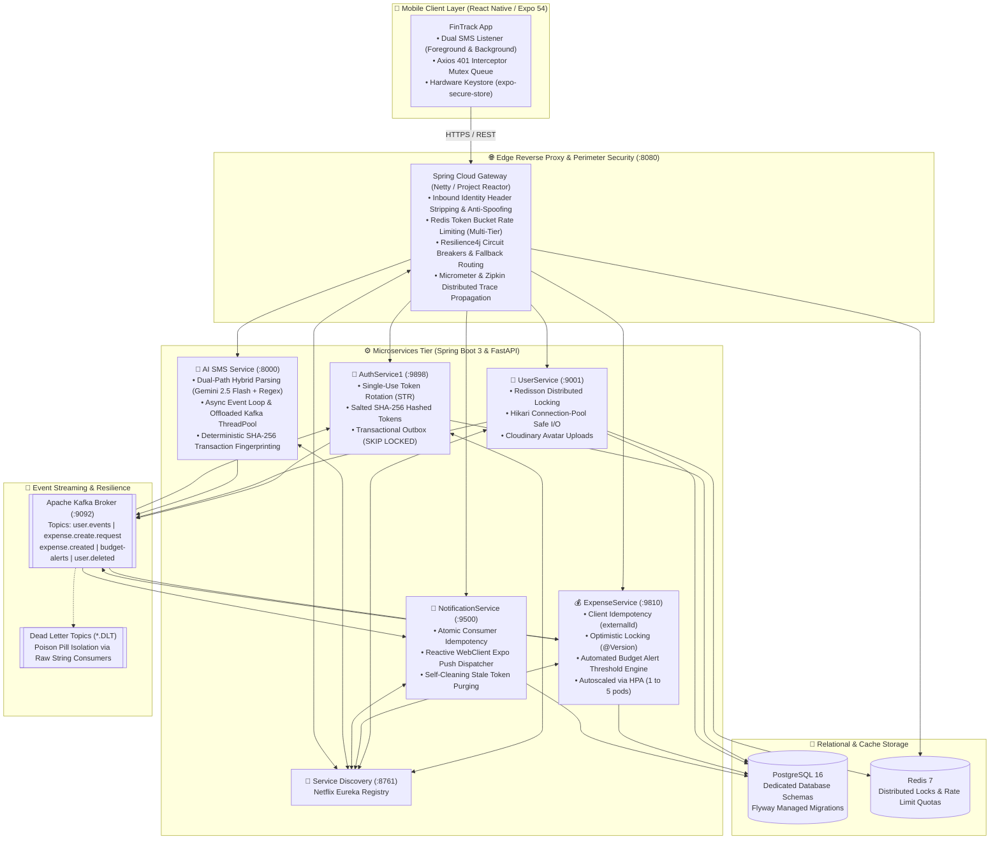

# 💳 FinTrack: Distributed Event-Driven Financial Platform & Mobile Client

> A production-grade, event-driven financial management ecosystem built with **Spring Boot 3 (Java 21)**, **FastAPI (Python 3.12)**, **Google Gemini 2.5 Flash**, **Apache Kafka**, **PostgreSQL**, **Redis**, and **Kubernetes**, paired with a cross-platform **React Native 0.81 (Expo 54)** mobile client featuring zero-touch financial SMS auto-detection.

[](https://openjdk.org/)
[](https://spring.io/projects/spring-boot)
[](https://www.python.org/)
[](https://fastapi.tiangolo.com/)
[](https://reactnative.dev/)
[](https://expo.dev/)
[](https://kafka.apache.org/)
[](https://www.postgresql.org/)
[](https://kubernetes.io/)
[](https://redis.io/)

---

## 🏛️ System Architecture



---

## ⚡ Core Engineering Highlights & Distributed Systems Patterns

### 1. Dual-Write Elimination via Transactional Outbox & PostgreSQL `SKIP LOCKED`
- **Problem**: Saving an entity to PostgreSQL while publishing an event to Kafka in separate operations risks ghost writes or lost messages if either system crashes mid-operation.
- **Solution**: Entity persistence and outbox event staging occur within the **exact same ACID database transaction**. A dedicated background worker leases pending events using:
  ```sql
  SELECT * FROM outbox_events
  WHERE (status = 'PENDING' AND next_retry_at <= :now)
     OR (status = 'PROCESSING' AND locked_until <= :now)
  ORDER BY created_at ASC
  LIMIT :limit
  FOR UPDATE SKIP LOCKED
  ```
- **Resilience**: Multiple worker pods lease disjoint event batches concurrently without row-lock contention. Failed workers are automatically reclaimed after the 60-second lease expiry. Transient Kafka failures back off exponentially before dead-lettering to `DEAD`.

### 2. Cryptographic Single-Use Refresh Token Rotation & Race Condition Defense
- **Problem**: Storing plaintext refresh tokens risks permanent session hijack upon database leak. Concurrent duplicate token rotation requests risk race conditions.
- **Solution**: Database stores **only salted SHA-256 hexadecimal hashes** of tokens. Presenting an already-rotated token invalidates all active sessions. Verified via **multi-threaded starter-pistol integration tests** using dual `CountDownLatch` instances (`readyLatch` + `startLatch`) where concurrent requests collide on database row deletion and cleanly return HTTP 409/401.

### 3. Poison-Pill Resilient Dead-Letter-Topic (DLT) Pipeline
- **Problem**: Corrupted JSON or unparseable messages crash typed consumers (`JsonDeserializer`) in native Kafka polling loops, causing head-of-line partition blocking and infinite `.DLT.DLT` recursive loops.
- **Solution**: All consumers wrap deserializers with `ErrorHandlingDeserializer`. Non-retryable errors immediately route unparseable records to `.DLT`. Dead-letter consumers use a dedicated container factory configured with **plain `StringDeserializer`**, safely consuming payloads as strings without JSON re-parsing and persisting forensic metadata to `failed_events`.

### 4. Hybrid AI Classification with Async Event Loop Preservation
- **Problem**: Pure LLMs hallucinate numbers or experience provider timeouts (HTTP 429/503), while pure regex fails across varied bank phrasing. Synchronous Kafka network calls freeze FastAPI’s `asyncio` event loop.
- **Solution**: Gemini 2.5 Flash performs semantic categorization while deterministic regex extracts exact rupee amounts and merchant UPI VPAs. Blocking Kafka delivery (`future.get()`) is offloaded to a dedicated threadpool worker (`loop.run_in_executor`). If Gemini times out (5000ms), the service enters **Graceful Degradation Mode** (`degraded: true`), falling back to local regex heuristics with zero 500 errors.

### 5. Multi-Instance Safe Redisson Distributed Locking
- **Problem**: Concurrent mutations to user identity records risk lost updates and phantom reads.
- **Solution**: Employs Redis-backed distributed locks keyed on `user:lock:{userId}` with strict **Lock $\to$ Transaction $\to$ Commit $\to$ Unlock** lifecycle ordering. PostgreSQL connections from HikariCP are borrowed only after the lock is secured, eliminating database connection pool exhaustion.

### 6. Mobile Refresh Storm Prevention & Interceptor Mutex
- **Problem**: When 5 parallel HTTP requests fail with HTTP 401 simultaneously on token expiry, sending 5 parallel refresh requests causes race collisions.
- **Solution**: An Axios response interceptor uses an `isRefreshing` mutex flag and queue (`failedQueue`). Only **one** refresh request is dispatched; remaining requests are parked and replayed with the new token.

---

## 📂 Repository Directory Structure

```text
fintrack/ (or expense-tracker-full-app/)
├── backend/                            # Microservices Backend & Orchestration
│   ├── AuthService1/                   # OAuth2-style Token Issuer & Security Authority (:9898)
│   ├── userService/                    # User Identity, Profile & Cloudinary Storage (:9001)
│   ├── expenseService/                 # Financial Ledger, Idempotency & Budget Engine (:9810)
│   ├── notification-service/           # Event-Driven In-App Feed & Expo Push Dispatcher (:9500)
│   ├── ai-sms-service/                 # FastAPI & Gemini 2.5 Flash Financial SMS Classifier (:8000)
│   ├── gateway/                        # Spring Cloud Gateway Reverse Proxy & Rate Limiter (:8080)
│   ├── service-discovery/              # Netflix Eureka Registry Server (:8761)
│   ├── k8s/                            # 12 Production Kubernetes Manifests + HPA
│   ├── expense_compose.yml             # Docker Compose Configuration for Local Development
│   └── README.md                       # Comprehensive Backend Engineering Documentation
│
└── mobile/                             # Cross-Platform Mobile Application
    ├── app/                            # Expo Router v6 Deep-Linked Navigation
    │   ├── (auth)/                     # Login, Registration & Password Reset Screens
    │   ├── (root)/                     # Dashboard, Ledger, Analytics & Notification Center
    │   └── services/                   # Axios Interceptor, Dual-SMS Listeners & Push Services
    ├── context/                        # Global State Providers (Auth, Transaction, Notification)
    ├── components/                     # Tailwind UI Components, Donut & Bar Charts
    └── README.md                       # Mobile Client Architecture & Telephony Documentation
```

---

## 🚀 Quickstart & Local Deployment

### Option A: Run on Local Kubernetes (Recommended)

Ensure Docker Desktop is running with **Kubernetes enabled**:

```powershell
# 1. Navigate to backend directory
cd backend

# 2. Build local container images
docker build -t expensetracker-service-discovery:latest ./service-discovery
docker build -t expensetracker-auth-service:latest ./AuthService1
docker build -t expensetracker-user-service:latest ./userService
docker build -t expensetracker-expense-service:latest ./expenseService
docker build -t expensetracker-notification-service:latest ./notification-service
docker build -t expensetracker-ai-sms-service:latest ./ai-sms-service
docker build -t expensetracker-gateway:latest ./gateway

# 3. Create namespace & inject secrets dynamically (Zero-Secret GitOps hygiene)
# Note: Ensure .env does not contain host overrides like POSTGRES_HOST=localhost (which would override microservice-config)
kubectl create namespace expense-tracker
kubectl create secret generic microservice-secrets --from-env-file=.env -n expense-tracker --dry-run=client -o yaml | kubectl apply -f -

# 4. Apply all manifests (Stateful services, deployments, services, HPA)
kubectl apply -f k8s/

# 5. Monitor until all pods report 1/1 Running
kubectl get pods -n expense-tracker -w
```

### Option B: Run via Docker Compose

```powershell
cd backend
docker compose -f expense_compose.yml up --build -d
```

### Option C: Run the React Native Mobile Client

```powershell
cd mobile
npm install
npx expo start
```
- Press `a` for Android Emulator or scan the QR code with the Expo Go app on a physical device.

---

## 🧪 Comprehensive Integration & Concurrency Test Suites

The backend features **250+ unit and integration tests** utilizing **Testcontainers** with real PostgreSQL 16 and Redis 7 containers:

```powershell
# Run AuthService1 integration & starter-pistol race condition tests:
cd backend/AuthService1
.\gradlew.bat test --tests org.example.integration.*

# Run userService multi-threaded Redisson concurrency tests:
cd ../userService
.\gradlew.bat test --tests sagar.userService.integration.*

# Run expenseService idempotency & outbox tests:
cd ../expenseService
.\mvnw.cmd test -Dtest=ExpenseIntegrationTest

# Run notification-service consumer & repository tests:
cd ../notification-service
.\mvnw.cmd test

# Run FastAPI AI SMS pytest suite:
cd ../ai-sms-service
.\venv\Scripts\activate
pytest -v
# (Optional) Run with test coverage (requires pytest-cov: pip install pytest-cov):
# pytest --cov=app tests/
```

---

## 📜 License

This project is licensed under the MIT License.

