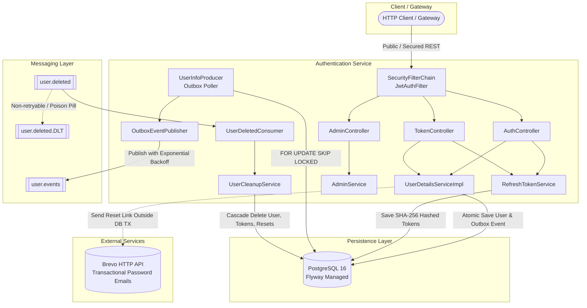

# 🔐 Authentication Service (`AuthService1`)

> Central identity issuer, credential authority, and cryptographic token rotation service built with **Spring Boot 3.5**, **Java 21**, **Spring Security 6**, **Apache Kafka**, and **PostgreSQL 16**. Functions as the OAuth2-style authentication backbone for the FinTrack microservices ecosystem.

---

### 🏛️ Architectural Overview & Distributed Patterns



---

### 🛡️ Core Engineering Highlights & Resiliency Patterns

#### 1. Cryptographic Single-Use Refresh Token Rotation & SHA-256 Hashing
- **The Problem Solved**: Refresh token theft, token replay attacks, and database breach exposure. Storing plaintext refresh tokens in a database allows attackers with read-access to compromise user sessions indefinitely.
- **Implementation**:
  - The client receives a high-entropy raw UUID token. The database stores **only** the salted SHA-256 hexadecimal hash (`tokens.token_hash`, 64 characters).
  - Implements **Single-Use Token Rotation (STR)**: Rotating a refresh token atomically revokes and purges the old token hash and issues a brand-new token pair.
  - **Replay Attack Defense**: Presenting an already-rotated token returns `401 Unauthorized` immediately.
  - **Optimistic Concurrency & Double-Spend Defense**: Concurrent requests presenting the identical token simultaneously collide on database deletion; one request succeeds (`200 OK`) and the concurrent duplicate is caught and translated to `409 Conflict` / `401 Unauthorized`.

#### 2. Transactional Outbox Pattern with `FOR UPDATE SKIP LOCKED` Worker Leasing
- **The Problem Solved**: The dual-write problem during account signup. Saving a user to the database while publishing an event to Kafka in separate operations risks orphan accounts or lost events upon broker failures.
- **Implementation**:
  - User creation and `USER_CREATED` outbox event persistence occur within the **exact same database transaction**.
  - Background worker (`UserInfoProducer`) leases pending events using `SELECT * FROM outbox_events WHERE ... FOR UPDATE SKIP LOCKED LIMIT 10` with a 30-second lease lock (`locked_until`).
  - Implements **exponential backoff** (`1s, 2s, 4s...` capped at `5m`) on transient Kafka failures and dead-letters events after 10 failed attempts (`DEAD` status) with truncated error tracking.

#### 3. Anti-Enumeration & Session-Revocation Password Reset Flow
- **The Problem Solved**: Account enumeration attacks and active session persistence after credential compromise.
- **Implementation**:
  - Calling `/auth/v1/forgot-password` with an unregistered email returns `200 OK ("Password reset email sent")` without leaking account existence.
  - Tokens expire after 15 minutes, are single-use, and are stored only as SHA-256 hashes.
  - **Complete Session Invalidation**: Successfully resetting a password immediately wipes **all active refresh tokens** for that user across every mobile and web device, forcing full re-authentication.

#### 4. Spring Security 6 & Stateless JWT Architecture
- **The Problem Solved**: Secure token parsing without database lookups across downstream microservices.
- **Implementation**:
  - Stateless architecture (`SessionCreationPolicy.STATELESS`) with a customized `JwtAuthFilter`.
  - Spring Security's internal `UserDetails` model is cleanly isolated within `AuthService1` (`CustomUserDetails`).
  - Downstream services (`userService`, `expenseService`, `gateway`) validate raw JWT signature claims independently without coupling to `AuthService1`'s internal persistence entities.

#### 5. Cascading Relational Event-Driven Cleanup (`user.deleted`)
- **The Problem Solved**: Eliminating orphaned credentials and tokens when a user account is deleted by the `userService`.
- **Implementation**:
  - `UserDeletedConsumer` consumes `user.deleted` and executes an atomic cascading purge across `RefreshToken`, `PasswordResetToken`, and `UserInfo`.
  - Fully idempotent: duplicate Kafka messages exit gracefully without throwing constraint or not-found exceptions.
  - Includes daily background housekeeping (`cleanupExpiredPasswordTokens`) to prune stale reset tokens.

#### 6. Resilient Kafka Dead-Letter-Topic (DLT) Pipeline
- **The Problem Solved**: Malformed or unparseable payloads (poison pills) blocking partition consumption.
- **Implementation**:
  - Configured with `DefaultErrorHandler` and a `DeadLetterPublishingRecoverer` routing unrecoverable records to `user.deleted.DLT`.
  - Employs `ErrorHandlingDeserializer` to trap deserialization errors before reaching consumer business logic.

---

### 🔌 REST API Specification

Base Path: `/auth/v1`

| Method | Endpoint | Access Control | Description |
| :--- | :--- | :--- | :--- |
| `POST` | `/auth/v1/signup` | Public | Registers a new user, persists atomic outbox event, and returns access/refresh tokens. |
| `POST` | `/auth/v1/login` | Public | Authenticates username & password; returns JWT access token and refresh token. |
| `POST` | `/auth/v1/refreshToken` | Public | Rotates single-use refresh token; invalidates old token and returns new token pair. |
| `POST` | `/auth/v1/forgot-password` | Public | Anti-enumeration password reset dispatch; generates hashed token & emails reset link. |
| `POST` | `/auth/v1/reset-password` | Public | Verifies token, updates password, marks token used, and revokes all active sessions. |
| `POST` | `/auth/v1/change/passwords`| Authenticated | Updates account password and invalidates active refresh tokens. |
| `POST` | `/auth/v1/change/username` | Authenticated | Updates username and issues refreshed JWT token. |
| `GET`  | `/auth/v1/ping` | Authenticated | Verifies authentication token and returns authenticated `userId`. |
| `GET`  | `/auth/v1/health` | Public | Liveness probe returning service status and timestamp. |
| `POST` | `/auth/v1/admin/users/{userId}/promote` | `ROLE_ADMIN` | Promotes target user to administrator (`204 No Content`). |
| `DELETE`| `/auth/v1/admin/users/{userId}/admin` | `ROLE_ADMIN` | Demotes admin user and immediately revokes all their active sessions. |

---

### 🗄️ Database Schema & Flyway Migrations

The database is version-controlled via Flyway with strict DDL validation (`spring.jpa.hibernate.ddl-auto=validate`):

- **`V1__init_auth.sql`**: Initial schema for `users`, `user_roles` (element collection join table with foreign-key cascade), `tokens` (refresh tokens), and `outbox_events`.
- **`V2__outbox_add_retry_fields.sql`**: Adds transactional outbox retry tracking columns (`attempt_count`, `next_retry_at`, `last_error`, `status`).
- **`V3__reset_pass_token.sql`**: Creates `password_reset_tokens` table with foreign-key cascade and index on token hash.
- **`V4__allow_multiple_tokens_per_user.sql`**: Drops unique constraint on `tokens.user_id` to support concurrent multi-device logins.
- **`V5__outbox_add_locked_until.sql`**: Adds `locked_until` column and `idx_outbox_claimable` index for non-blocking worker leasing.

---

### 🧪 Comprehensive Integration & Concurrency Testing Suite

The `AuthService1` test suite incorporates **120+ unit tests** and **21 PBC-grade integration tests** covering security guards, replay attacks, race conditions, and event cleanup:

```bash
AuthService1/app/src/test/java/org/example/
├── integration/
│   ├── SignupIntegrationTest.java           # Atomic outbox write & duplicate username conflict guards
│   ├── RefreshTokenIntegrationTest.java      # Single-use rotation, SHA-256 DB verification, replay defense & 2-thread starter-pistol race test
│   ├── PasswordResetIntegrationTest.java     # Anti-enumeration, email interception with ArgumentCaptor, password update & session wipe
│   ├── AdminSecurityIntegrationTest.java     # RBAC enforcement, 401/403 rejection, admin promotion/demotion & session termination
│   └── UserCleanupIntegrationTest.java       # user.deleted consumer cascade deletion, idempotency & token housekeeping
```

#### Running the Test Suite:
```bash
# Navigate to service directory
cd AuthService1

# Run all unit tests (Windows: .\gradlew.bat test)
./gradlew test

# Run all integration test suites
./gradlew test --tests org.example.integration.* --no-daemon

# Run specific integration test suite
./gradlew test --tests org.example.integration.RefreshTokenIntegrationTest --no-daemon
```

---

### ⚙️ Environment Variables & Configuration

| Variable | Description | Default / Example |
| :--- | :--- | :--- |
| `SERVER_PORT` | HTTP port | `9898` |
| `POSTGRES_HOST` | PostgreSQL Host | `localhost` |
| `POSTGRES_PORT` | PostgreSQL Port | `5432` |
| `POSTGRES_DB` | Database Name | `authservice` |
| `POSTGRES_USER` | Database Username | - |
| `POSTGRES_PASSWORD` | Database Password | - |
| `KAFKA_BOOTSTRAP_SERVERS` | Kafka Broker addresses | `localhost:9092` |
| `JWT_SECRET` | Base64-encoded HMAC-SHA256 Secret (>= 256 bits) | - |
| `JWT_EXPIRATION` | Access token lifespan (ms) | `3600000` (1 hour) |
| `JWT_REFRESH_EXPIRATION`| Refresh token lifespan (ms) | `604800000` (7 days) |
| `BREVO_API_KEY` | Brevo (Sendinblue) Transactional Email API Key | - |
| `BREVO_SENDER_EMAIL` | Originating email address | `noreply@fintrack.com` |
| `BREVO_SENDER_NAME` | Originating sender name | `FinTrack` |
| `EUREKA_URI` | Service Discovery Server URI | `http://localhost:8761/eureka/` |
| `ZIPKIN_ENDPOINT` | Distributed Tracing Ingestion Endpoint | `http://localhost:9411/api/v2/spans` |
