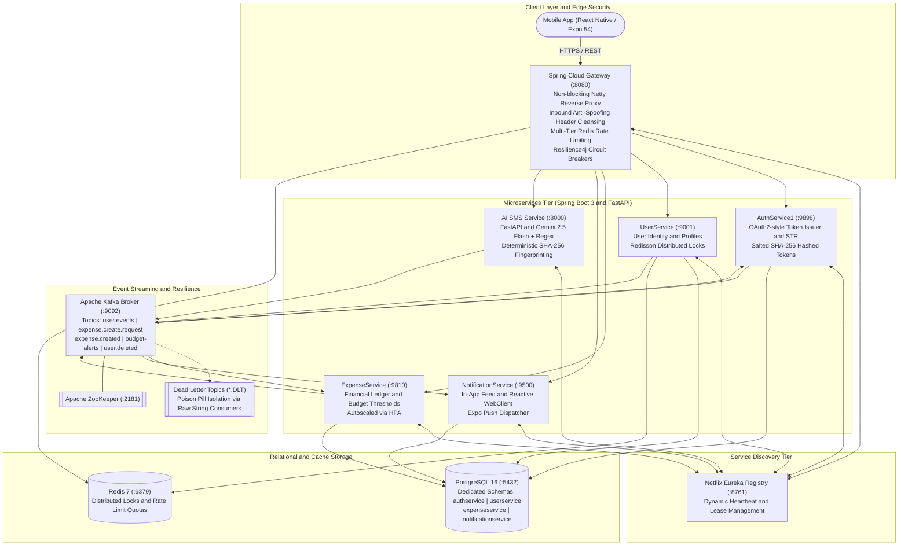
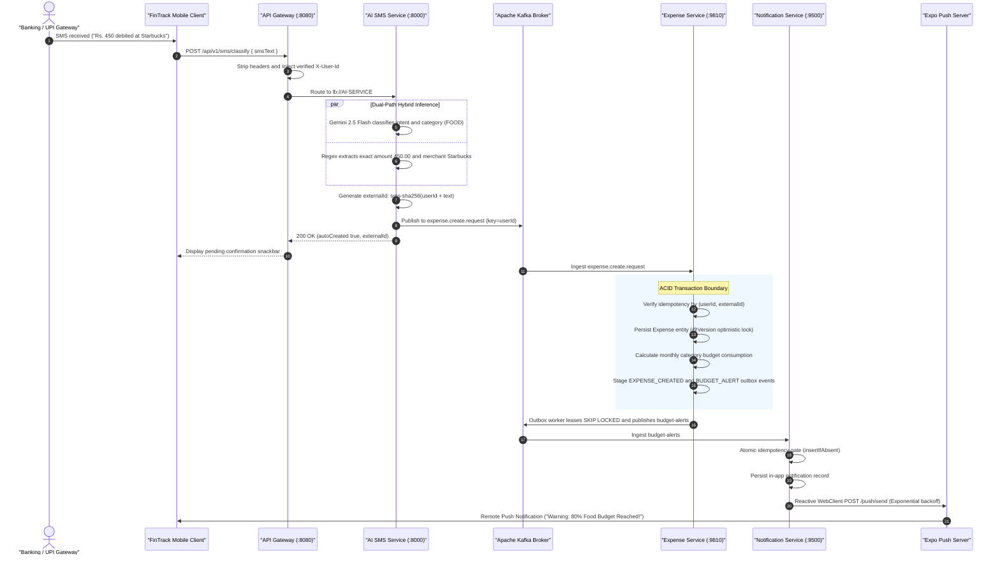
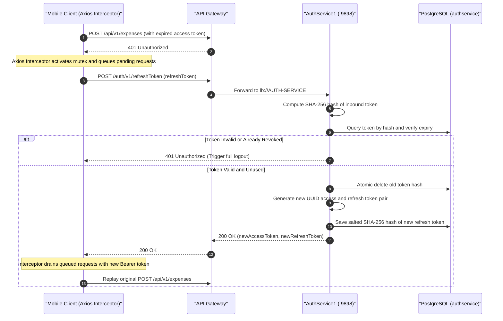
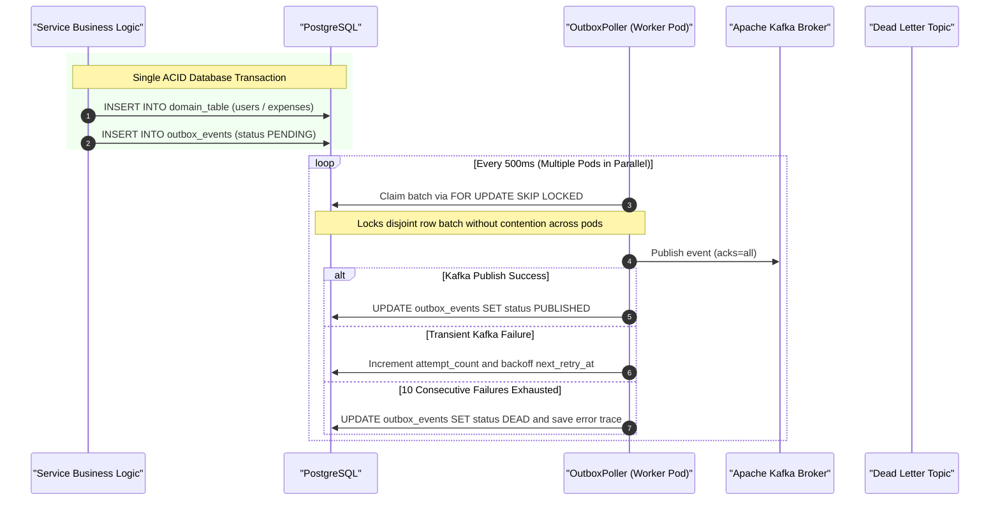
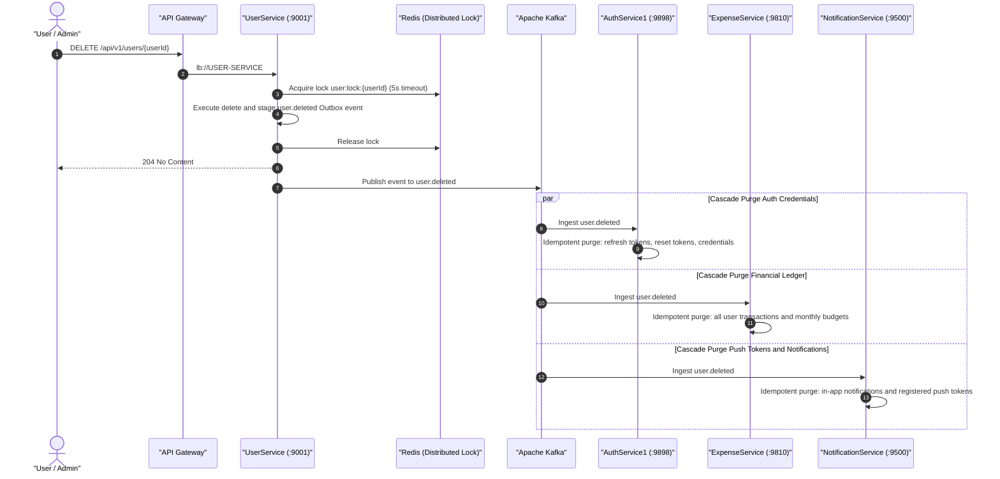

# 💳 FinTrack: Distributed Event-Driven Microservices Backend

> A production-grade, event-driven financial management and automated bookkeeping backend built with **Spring Boot 3 (Java 21)**, **FastAPI (Python 3.12)**, **Google Gemini 2.5 Flash**, **Apache Kafka**, **PostgreSQL 16**, **Redis 7**, and **Kubernetes**. Engineered for high throughput, strict transactional consistency, zero dual-writes, and resilience against distributed system failure modes.

[](https://openjdk.org/)
[](https://spring.io/projects/spring-boot)
[](https://www.python.org/)
[](https://fastapi.tiangolo.com/)
[](https://kafka.apache.org/)
[](https://www.postgresql.org/)
[](https://kubernetes.io/)
[](https://redis.io/)

---

## 🏛️ Master System Architecture



---

## 🗺️ Microservices Portfolio & Documentation

Each microservice is an independently deployable, isolated bounded context with its own database schema, domain models, integration test suite, and dedicated documentation:

| Microservice | Port | Framework / Tech | Primary Role | Documentation |
| :--- | :--- | :--- | :--- | :--- |
| **`gateway`** | `8080` | Spring Cloud Gateway, Netty, Redis, Resilience4j | Edge reverse proxy, anti-spoofing filter, Redis token bucket rate limiter, circuit breakers. | [gateway/README.md](file:///c:/Users/greatest/Work-dev/expense-tracker-full-app/backend/gateway/README.md) |
| **`AuthService1`** | `9898` | Spring Boot 3, Spring Security 6, PostgreSQL | OAuth2-style auth authority, single-use refresh token rotation (STR), SHA-256 hashing, anti-enumeration reset. | [AuthService1/README.md](file:///c:/Users/greatest/Work-dev/expense-tracker-full-app/backend/AuthService1/README.md) |
| **`userService`** | `9001` | Spring Boot 3, Redisson, PostgreSQL, Cloudinary | User identity lifecycle, Redisson distributed locking (`user:lock:{id}`), Cloudinary avatar media uploads. | [userService/README.md](file:///c:/Users/greatest/Work-dev/expense-tracker-full-app/backend/userService/README.md) |
| **`expenseService`** | `9810` | Spring Boot 3, PostgreSQL, Kafka, HPA | Core financial ledger, client idempotency (`externalId`), optimistic locking (`@Version`), budget threshold alerts. | [expenseService/README.md](file:///c:/Users/greatest/Work-dev/expense-tracker-full-app/backend/expenseService/README.md) |
| **`ai-sms-service`** | `8000` | Python 3.12, FastAPI, Gemini 2.5 Flash, Kafka | Dual-path hybrid classification (Gemini semantic parsing + regex amount validation), graceful degradation. | [ai-sms-service/README.md](file:///c:/Users/greatest/Work-dev/expense-tracker-full-app/backend/ai-sms-service/README.md) |
| **`notification-service`**| `9500` | Spring Boot 3, Spring WebFlux, PostgreSQL | Atomic consumer idempotency gate, non-blocking reactive Expo push dispatcher, stale token pruning. | [notification-service/README.md](file:///c:/Users/greatest/Work-dev/expense-tracker-full-app/backend/notification-service/README.md) |
| **`service-discovery`** | `8761` | Netflix Eureka Server | Dynamic service registration, heartbeat monitoring, and client-side load balancing. | — |
| **`k8s`** | — | Kubernetes 1.36, HPA, ConfigMaps, Secrets | Cloud-native orchestration, 12 manifests, tuned cold-start probes, multi-DB ConfigMap initialization. | [k8s/README.md](file:///c:/Users/greatest/Work-dev/expense-tracker-full-app/backend/k8s/README.md) |

---

## 🔄 End-to-End Distributed System Flows

### 1. Zero-Touch Financial SMS Ingestion to Ledger Pipeline

This pipeline illustrates how an incoming bank transaction SMS on a mobile device automatically transitions through hybrid AI reasoning, event streaming, ledger persistence, budget threshold analysis, and instant push notification without human intervention:



---

### 2. Cryptographic Single-Use Refresh Token Rotation (STR) Flow

Prevents token replay attacks, session hijacking, and double-spend race conditions:



---

### 3. Dual-Write Elimination via Transactional Outbox (`SKIP LOCKED`)

Guarantees 100% reliable event delivery to Apache Kafka without distributed 2PC transactions:



---

### 4. GDPR-Compliant Cascading Account Deletion Flow

Illustrates how deleting a user in `userService` cascades asynchronously across the entire ecosystem without tight coupling:



---

## 📨 Global Kafka Event Catalog

| Topic Name | Partition Key | Publisher Service | Consumer Services | Payload Schema / Purpose |
| :--- | :--- | :--- | :--- | :--- |
| **`expense.create.request`** | `userId` | `ai-sms-service` | `expenseService` | Dispatches high-confidence AI-parsed SMS transaction records for automated ledger insertion. |
| **`expense.created`** | `userId` | `expenseService` | `notification-service` | Emitted when an expense is persisted; triggers in-app notification confirmation. |
| **`budget-alerts`** | `userId` | `expenseService` | `notification-service` | Emitted when spending crosses 50%, 80%, or 100% of a monthly category limit; dispatches Expo push alerts. |
| **`user.events`** | `userId` | `AuthService1` | `userService` | Broadcasts user registration (`USER_CREATED`) to provision downstream profile metadata. |
| **`user.deleted`** | `userId` | `userService` | `AuthService1`, `expenseService`, `notification-service` | Triggers atomic cascading cleanup across credentials, transactions, budgets, and push tokens. |
| **`*.DLT` Topics** | `null` | DeadLetterPublishingRecoverer | Dedicated DLT Consumers | Raw string poison pill isolation store; prevents head-of-line partition blocking. |

---

## 🛡️ Distributed Systems Patterns Matrix

| Architectural Pattern | Problem Solved | Key Technologies & Implementations |
| :--- | :--- | :--- |
| **Transactional Outbox** | Eliminates dual-write inconsistency between DB and Kafka | PostgreSQL `SELECT FOR UPDATE SKIP LOCKED`, exponential retry backoff, `DEAD` status transitions. |
| **Distributed Locking** | Eliminates concurrent race conditions on user profile mutations | Redisson Redis locks keyed on `user:lock:{id}` with strict Lock $\to$ DB Transaction $\to$ Unlock ordering. |
| **Single-Use Token Rotation** | Prevents refresh token replay and session hijack attacks | Salted SHA-256 database hashes, single-use token lifecycle, starter-pistol concurrency defense. |
| **Poison Pill Resiliency** | Prevents unparseable JSON from crashing Kafka partition loops | `ErrorHandlingDeserializer`, Spring `DeadLetterPublishingRecoverer`, dedicated `StringDeserializer` DLT consumer. |
| **Dual-Path Hybrid NLP** | Balances LLM semantic reasoning with exact monetary precision | Gemini 2.5 Flash for categorization + regex for rupee amounts, UPI VPAs, and graceful local fallback. |
| **Client Idempotency** | Prevents duplicate ledger entries on network retries | Client UUID `externalId` enforced via DB composite unique constraint `(user_id, external_id)`. |
| **Non-Blocking Push I/O** | Prevents third-party push API latencies from blocking worker pools | Spring WebFlux `Reactive WebClient` with jittered exponential retry and dead token auto-purging. |
| **Distributed Rate Limiting** | Defends against brute-force attacks and noisy neighbors | Redis token-bucket rate limiting via `UserKeyResolver` enforced at edge gateway Netty layer. |
| **Horizontal Pod Autoscaling** | Automatically absorbs month-end financial traffic spikes | Kubernetes HPA scaling `expense-service` (1–5 pods) based on 70% target CPU utilization. |

---

## 🚀 Quickstart & Local Orchestration

### Option A: Run via Docker Compose (Recommended for Local Dev)

The entire microservices platform, along with Kafka, ZooKeeper, PostgreSQL, Redis, Zipkin, Prometheus, and Grafana, can be launched with a single command:

```powershell
# 1. Navigate to backend directory
cd backend

# 2. Start all infrastructure and microservice containers
docker compose -f expense_compose.yml up --build -d

# 3. View streaming logs across services
docker compose -f expense_compose.yml logs -f
```

### Option B: Run on Local Kubernetes

Ensure Docker Desktop has **Kubernetes enabled**:

```powershell
cd backend

# 1. Build local container images
docker build -t expensetracker-service-discovery:latest ./service-discovery
docker build -t expensetracker-auth-service:latest ./AuthService1
docker build -t expensetracker-user-service:latest ./userService
docker build -t expensetracker-expense-service:latest ./expenseService
docker build -t expensetracker-notification-service:latest ./notification-service
docker build -t expensetracker-ai-sms-service:latest ./ai-sms-service
docker build -t expensetracker-gateway:latest ./gateway

# 2. Create cluster namespace & inject secrets dynamically
kubectl create namespace expense-tracker
kubectl create secret generic microservice-secrets --from-env-file=.env -n expense-tracker --dry-run=client -o yaml | kubectl apply -f -

# 3. Deploy all 12 manifests
kubectl apply -f k8s/

# 4. Monitor until all pods report 1/1 Running
kubectl get pods -n expense-tracker -w
```

---

## 🧭 Infrastructure & Observability Port Reference

| Service / Tool | Local Port | URL / Health Endpoint | Purpose |
| :--- | :--- | :--- | :--- |
| **Spring Cloud Gateway** | `8080` | `http://localhost:8080/actuator/health` | Public Edge Perimeter & Reverse Proxy |
| **Netflix Eureka Registry**| `8761` | `http://localhost:8761` | Service Registry Web Dashboard |
| **Zipkin Distributed Tracing**| `9411`| `http://localhost:9411/zipkin/` | End-to-End Distributed Trace Explorer |
| **PostgreSQL 16 Database** | `5432` | `localhost:5432` | Multi-Database Relational Storage |
| **Redis 7 Cache & Locks** | `6379` | `localhost:6379` | Distributed Locks & Rate Limit Quotas |
| **Apache Kafka Broker** | `9092` | `localhost:9092` | High-Throughput Event Streaming Cluster |
| **Apache ZooKeeper** | `2181` | `localhost:2181` | Kafka Cluster Coordination |
