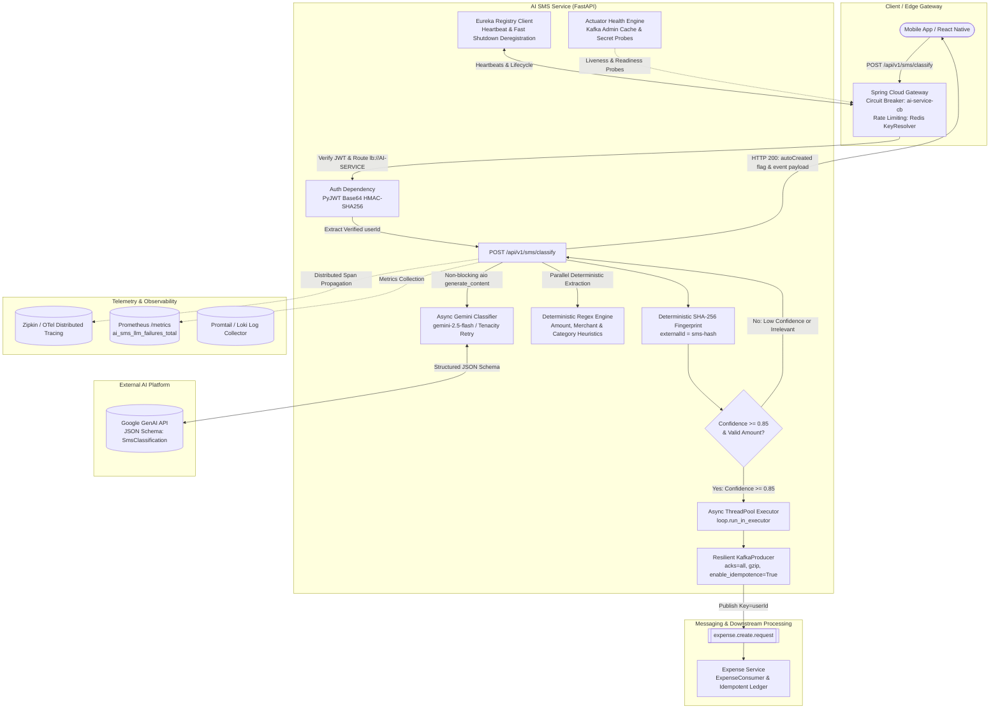

# 🤖 AI SMS Service (`ai-sms-service`)

> Intelligent financial notification classification and transaction parsing engine built with **Python 3.12**, **FastAPI**, **Google Gemini 2.5 Flash**, and **Apache Kafka**. Executes dual-path hybrid NLP parsing (structured LLM inference coupled with deterministic regex extraction), computes deterministic transaction fingerprints, and dispatches verified expense events to Apache Kafka with non-blocking event-loop isolation.

---

### 🏛️ Architectural Overview & Distributed Patterns



---

### 🛡️ Core Engineering Highlights & Resiliency Patterns

#### 1. Non-Blocking Async Event Loop with Offloaded Kafka ThreadPool Dispatch
- **The Problem Solved**: FastAPI operates on an asynchronous `asyncio` event loop. Synchronous network I/O or blocking socket waits within route handlers freeze the loop, halting concurrent request processing and causing severe tail latencies under mobile traffic bursts.
- **Implementation**:
  - LLM classification utilizes Google GenAI’s native asynchronous client (`client.aio.models.generate_content`), ensuring the event loop remains free while awaiting remote model generation.
  - While `kafka-python`’s `future.get(timeout=15)` is inherently blocking, the service bridges the async/sync boundary via `loop.run_in_executor(None, publish_expense_event, event.model_dump())`.
  - Kafka delivery acknowledgment blocks only a dedicated threadpool worker, allowing the FastAPI event loop to concurrently serve other classification requests.

#### 2. Dual-Path Hybrid Classification & Deterministic Safety Anchors
- **The Problem Solved**: Pure LLM processing can hallucinate transaction amounts or fail on unexpected network timeouts. Conversely, pure regex parsers fail to understand complex phrasing across diverse financial institutions and SMS gateway providers.
- **Implementation**:
  - **Path A (LLM Semantic Reasoning)**: Gemini 2.5 Flash classifies intent (`expense`, `income`, `irrelevant`), assigns a normalized confidence score (`0.0`–`1.0`), and categorizes the transaction against a predefined domain ontology (`FOOD`, `TRANSPORT`, `SHOPPING`, `BILLS`, `ENTERTAINMENT`, `HEALTH`, `SALARY`, `FREELANCE`, `INVESTMENT`, `GIFT`, `OTHERS`) strictly enforced via Pydantic JSON schemas.
  - **Path B (Deterministic Heuristics)**: An optimized regex engine extracts monetary amounts across Indian denomination patterns (`Rs.`, `INR`, `₹`, comma grouping), disambiguates balance alerts from actual debit/credit verbs, extracts merchant identifiers from UPI VPAs (`@ybl`, `@icici`, etc.) or positional grammar (`at`, `to`, `from`), and provides keyword-based category fallback guessing.
  - The final entity marries LLM semantic classification with exact regex-validated monetary precision.

#### 3. Graceful LLM Degradation & Exponential Backoff
- **The Problem Solved**: External LLM rate limits (HTTP 429), provider outages (HTTP 500/503), or network latency spikes must never cause service downtime, crash endpoints, or result in HTTP 500 errors to the mobile client.
- **Implementation**:
  - Outbound Gemini calls are guarded by `tenacity` retry logic: `stop_after_attempt(2)`, exponential backoff (`min=1s`, `max=3s`), selectively filtering retryable exceptions (`TimeoutError`, `errors.ServerError`, HTTP `429`, `500`, `503`, `504`).
  - Configurable hard timeout (`GEMINI_TIMEOUT_MS=5000`) prevents upstream connection starvation.
  - On exhausted retries or timeout expiry, the engine enters **Graceful Degradation Mode**:
    - Flags `degraded: true` in the API response.
    - Falls back to local keyword heuristics (`guess_category`) and regex amount extraction.
    - Increments Prometheus failure metrics (`ai_sms_llm_failures_total{reason="timeout|error"}`).
    - Returns HTTP 200 with `autoCreated: false`, enabling the mobile app to prompt the user with pre-filled suggestions rather than failing silently.

#### 4. Idempotent Transaction Fingerprinting (`externalId`)
- **The Problem Solved**: Mobile SMS background listeners can process duplicate notifications or re-trigger sync runs, risking duplicate expense creation in the accounting ledger.
- **Implementation**:
  - Generates a deterministic SHA-256 transaction fingerprint:
    $$\text{externalId} = \text{"sms-"} + \text{SHA256}(\text{userId} + \text{smsText})[0:16]$$
  - Carried in the Kafka payload (`SmsExpenseEvent.externalId`) directly into `expenseService`.
  - Downstream database constraints and idempotency filters detect duplicated external IDs, treating re-deliveries as idempotent no-ops.

#### 5. Enterprise Kafka Producer Resiliency & Partition Affinity
- **The Problem Solved**: Network partitions, broker rebalances, or producer restarts could lead to lost messages, out-of-order ledger updates, or broker connection thrashing.
- **Implementation**:
  - Configured with `acks="all"` to guarantee replication persistence across all in-sync replicas before acknowledging delivery.
  - `enable_idempotence=True` prevents broker duplicate writes within the producer session.
  - `retries=10`, `max_in_flight_requests_per_connection=5`, `compression_type="gzip"`, and `linger_ms=10` optimize network batching while preserving strict per-partition ordering.
  - Sets message key to `userId`, guaranteeing that all transactions belonging to a user land on the same Kafka partition and are processed strictly in chronological order by `expenseService`.
  - FastAPI lifespan management executes a graceful shutdown hook (`_producer.flush(timeout=10.0)` followed by `_producer.close()`), ensuring zero message drop during container rolling updates.

#### 6. Gateway Circuit Breaking, Service Discovery & Observability
- **The Problem Solved**: Slow AI responses must not cascade upstream or exhaust API Gateway Netty worker threads. Health checks must not overwhelm Kafka broker metadata.
- **Implementation**:
  - Integrated into Netflix Eureka service discovery (`ai-service`). Lifespan shutdown explicitly invokes `eureka_client.stop_async()` for instant gateway deregistration without waiting for the 90-second lease expiry.
  - Protected at the API Gateway by Resilience4j circuit breaker (`ai-service-cb`) with a 15-second call timeout and automatic fallback routing to `/fallback/ai`.
  - Exposes Spring Boot Actuator-compatible endpoints: `/actuator/health`, `/actuator/health/liveness`, `/actuator/health/readiness`.
  - Broker health checks use a cached `KafkaAdminClient` with a 5-second TTL and 3-second connect timeout, preventing socket saturation under aggressive Kubernetes / Docker health probes.
  - OpenTelemetry distributed tracing exports spans directly to Zipkin (`/api/v2/spans`). A custom `TraceContextFilter` automatically injects active `trace_id` and `span_id` into all application log lines (`logs/ai-service.log`) for centralized ingestion by Promtail and Grafana Loki.

---

### 🔌 REST API Specification

Base Path: `/api/v1/sms`  
*All endpoints require Bearer JWT authentication via the `Authorization` header. Token secret decoding matches the base64-encoded HMAC-SHA256 contract established across the microservice ecosystem.*

| Method | Endpoint | Description | Query / Body Parameters |
| :--- | :--- | :--- | :--- |
| `POST` | `/api/v1/sms/classify` | Classifies SMS, extracts transaction details, and auto-dispatches to Kafka if confidence >= 0.85. | JSON: `SmsClassifyRequest` (`smsText`) |
| `GET` | `/actuator/health` | Comprehensive readiness & dependency health check (Kafka broker connectivity, Gemini key, JWT secret). | None |
| `GET` | `/actuator/health/readiness` | Alias for `/actuator/health` used by container orchestrators. | None |
| `GET` | `/actuator/health/liveness` | Zero-dependency process liveness probe (returns HTTP 200 immediately). | None |
| `GET` | `/metrics` | Prometheus metrics scrape endpoint (HTTP request durations, latency histograms, custom LLM counters). | None |

---

#### Request & Response Schemas

##### 1. High-Confidence Transaction (Auto-Created & Published to Kafka)
**Request:**
```http
POST /api/v1/sms/classify HTTP/1.1
Host: gateway:8080
Authorization: Bearer <JWT_TOKEN>
Content-Type: application/json

{
  "smsText": "Sent Rs. 349.00 from HDFC Bank to Swiggy on 12-08-2026 via UPI. Ref 482910."
}
```

**Response (`200 OK`):**
```json
{
  "label": "expense",
  "confidence": 0.98,
  "autoCreated": true,
  "degraded": false,
  "event": {
    "externalId": "sms-e3b0c44298fc1c14",
    "userId": "user-4891-uuid",
    "amount": 349.0,
    "currency": "INR",
    "type": "EXPENSE",
    "category": "FOOD",
    "title": "Swiggy",
    "note": "Auto-detected from SMS",
    "transactionDate": "2026-08-12"
  }
}
```

##### 2. Low-Confidence or Ambiguous Transaction (Manual User Confirmation Required)
**Response (`200 OK`):**
```json
{
  "label": "expense",
  "confidence": 0.72,
  "autoCreated": false,
  "degraded": false,
  "event": {
    "externalId": "sms-78fa23bc110a99c2",
    "userId": "user-4891-uuid",
    "amount": 1200.0,
    "currency": "INR",
    "type": "EXPENSE",
    "category": "OTHERS",
    "title": "SMS detected transaction",
    "note": "Auto-detected from SMS",
    "transactionDate": "2026-08-12"
  }
}
```

##### 3. Irrelevant / Non-Financial Notification (Ignored)
**Request:**
```json
{
  "smsText": "Your OTP for Aadhaar verification is 482910. Do not share this with anyone."
}
```

**Response (`200 OK`):**
```json
{
  "label": "irrelevant",
  "confidence": 0.99,
  "autoCreated": false,
  "degraded": false,
  "event": null
}
```

---

### 🧪 Comprehensive Testing Suite

The `ai-sms-service` test suite is powered by **pytest**, utilizing extensive mocking of asynchronous LLM calls, Kafka brokers, and Eureka registries to ensure deterministic, sub-second execution without external network dependencies:

```bash
ai-sms-service/tests/
├── test_auth.py                # Base64 HMAC-SHA256 JWT validation, expired tokens, missing headers & claim extraction
├── test_classifier.py          # Gemini prompt structuring, JSON schema validation, timeout handling & retry logic
├── test_main_api.py            # FastAPI endpoints: /classify logic, threshold gating (0.85), health & liveness probes
├── test_producer.py            # Kafka producer threadpool dispatch, partition keying, retries & graceful shutdown
├── test_regex_extractor.py     # Regex accuracy: multi-format amounts, UPI VPA extraction, merchant parsing & keyword heuristics
└── test_schemas.py             # Pydantic v2 model boundary tests: validation errors, payload size limits & constraints
```

#### Running AI SMS Service Tests:
```bash
# Navigate to service directory
cd ai-sms-service

# Activate Python virtual environment
source venv/bin/activate  # On Windows: .\venv\Scripts\activate

# Run all test suites with verbose output
pytest -v

# (Optional) Run with test coverage report (requires pytest-cov: pip install pytest-cov)
pytest --cov=app tests/
```

---

### ⚙️ Environment Variables & Configuration

| Variable | Description | Default / Example |
| :--- | :--- | :--- |
| `SERVICE_PORT` | HTTP Port for Uvicorn server | `8000` |
| `GEMINI_API_KEY` | Google Gemini API Key for model inference | - |
| `GEMINI_MODEL` | Gemini model variant | `gemini-2.5-flash` |
| `GEMINI_TIMEOUT_MS` | Maximum timeout for remote LLM inference (ms) | `5000` |
| `JWT_SECRET` | Base64-encoded HMAC-SHA256 secret key | - |
| `KAFKA_BOOTSTRAP_SERVERS` | Apache Kafka broker connection address | `localhost:9092` |
| `EUREKA_URI` | Service Discovery Eureka Server URI | `http://localhost:8761/eureka/` |
| `EUREKA_INSTANCE_HOST` | Hostname / IP announced to Eureka (useful in Docker) | Dynamic IP / hostname |
| `ZIPKIN_ENDPOINT` | OpenTelemetry Zipkin collector span ingestion URL | `http://localhost:9411/api/v2/spans` |
