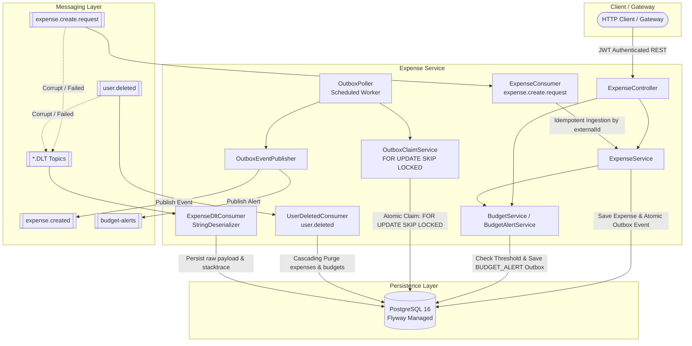

# 💰 Expense Service (`expenseService`)

> Core financial ledger, categorized transaction engine, and automated budget monitor built with **Spring Boot 3.5**, **Java 21**, **Apache Kafka**, and **PostgreSQL 16**. Enforces client idempotency, multi-instance transactional outbox leasing (`FOR UPDATE SKIP LOCKED`), optimistic locking concurrency, automated budget threshold alert suppression, and poison-pill resilient event consumption.

---

### 🏛️ Architectural Overview & Distributed Patterns



---

### 🛡️ Core Engineering Highlights & Resiliency Patterns

#### 1. Multi-Instance Safe Transactional Outbox (`FOR UPDATE SKIP LOCKED`)
- **The Problem Solved**: The dual-write problem during financial transaction creation. If the database commit succeeds but publishing to Kafka fails (or vice versa), state drifts across services. Furthermore, running multiple replicas of `expense-service` risks duplicate publishes without distributed coordination.
- **Implementation**:
  - Every expense creation or budget alert threshold trigger atomically saves an `OutboxEvent` (`status = PENDING`, `next_retry_at = NOW()`) inside the **exact same ACID database transaction** as the domain entity.
  - Dedicated background leasing service (`OutboxClaimService`) uses PostgreSQL native row-level locking:
    ```sql
    SELECT * FROM outbox_events
    WHERE (status = 'PENDING' AND next_retry_at <= :now)
       OR (status = 'PROCESSING' AND locked_until <= :now)
    ORDER BY created_at ASC
    LIMIT :limit
    FOR UPDATE SKIP LOCKED
    ```
  - **Dead Worker Recovery**: If a worker crashes mid-publish, other instances automatically reclaim expired leases (`status = 'PROCESSING' AND locked_until <= :now`) after the 60-second lease window.
  - **Exponential Backoff**: Transient Kafka failures back off exponentially (`1s, 2s, 4s...` capped at `5m`) up to 10 attempts before transitioning to `DEAD` status with truncated error logging.

#### 2. DLT Poison Pill Resiliency & Raw String Ingestion
- **The Problem Solved**: When a message on Kafka is corrupted (e.g. invalid JSON syntax), typed consumers (`JsonDeserializer`) throw deserialization exceptions inside the native Kafka client polling loop, causing infinite crash loops and partition starvation.
- **Implementation**:
  - `KafkaConsumerConfig` wraps all `JsonDeserializer` instances with `ErrorHandlingDeserializer`. Bad payloads are intercepted, tagged with failure headers, and passed to Spring's `DefaultErrorHandler`.
  - Non-retryable errors (`DeserializationException`, `IllegalArgumentException`) immediately route to `.DLT` via `DeadLetterPublishingRecoverer` without wasteful retries.
  - **Poison-Proof DLT Ingestion**: `ExpenseDltConsumer` uses a dedicated `dltKafkaListenerContainerFactory` configured with **`StringDeserializer`**. It consumes the raw payload as a plain `String` (never re-parsing JSON), preventing recursive DLT crashes, and safely persists diagnostic details to the `failed_events` table with a 1000-character safety truncation on error messages.

#### 3. Client-Driven Idempotency (`externalId` & Unique Constraint)
- **The Problem Solved**: Network timeouts causing client retries, leading to double-billing or duplicate expense records.
- **Implementation**:
  - The client provides a unique UUID `externalId` per transaction.
  - PostgreSQL enforces a composite unique constraint:
    ```sql
    CONSTRAINT uk_user_external UNIQUE (user_id, external_id)
    ```
  - `ExpenseService.createExpense()` performs an idempotency lookup: if an expense already exists for `(userId, externalId)`, it returns the existing entity immediately (`HTTP 201 Created`) without re-executing budget checks or generating duplicate outbox events.

#### 4. Automated Budget Alert Threshold Engine
- **The Problem Solved**: Alert fatigue and duplicate notifications when multiple expenses occur near category limits.
- **Implementation**:
  - Upon every expense persistence, `BudgetAlertService` calculates current monthly expenditure against the category's configured monthly budget.
  - Detects threshold crossings (`50%`, `80%`, `100%`).
  - Tracks `last_alert_threshold` on the `Budget` entity. If a user spends more while remaining within the same threshold tier (e.g. 82% to 88%), redundant alert events are suppressed.
  - When a new threshold is crossed, an atomic `BUDGET_ALERT` event is persisted to `outbox_events` for downstream push notification dispatch.

#### 5. Optimistic Concurrency Control (`@Version`)
- **The Problem Solved**: Lost updates when concurrent clients update the same expense record.
- **Implementation**:
  - `Expense` entity leverages Hibernate `@Version private Long version;`.
  - Concurrent modifications trigger `ObjectOptimisticLockingFailureException`, which `GlobalExceptionHandler` intercepts and translates to a clean `HTTP 409 Conflict`.

#### 6. Cascading Event-Driven Account Purge (`user.deleted`)
- **The Problem Solved**: GDPR / data retention compliance and storage cleanup when an account is deleted in `userService`.
- **Implementation**:
  - `UserDeletedConsumer` consumes `user.deleted` events.
  - `UserCleanupService` executes an atomic deletion across all `expenses` and `budget` entries belonging to the user in a single transaction.

---

### 🔌 REST API Specification

Base Path: `/api/v1/expenses`  
*All endpoints require Bearer JWT authentication unless noted otherwise. User identity is derived strictly from the verified security context (`authentication.getName()`).*

| Method | Endpoint | Description | Query / Body Parameters |
| :--- | :--- | :--- | :--- |
| `POST` | `/api/v1/expenses` | Creates an expense transaction (Idempotent via `externalId`). | JSON: `ExpenseDto` (`amount`, `category`, `type`, `title`, `transactionDate`, `externalId`) |
| `PUT` | `/api/v1/expenses` | Updates an existing expense transaction. | JSON: `ExpenseDto` (`externalId`, updated fields) |
| `GET` | `/api/v1/expenses/{externalId}` | Fetches a specific expense transaction by external ID. | Path: `externalId` |
| `DELETE` | `/api/v1/expenses/{externalId}` | Deletes an expense transaction (`204 No Content`). | Path: `externalId` |
| `GET` | `/api/v1/expenses` | Paginated and filtered expense transaction history. | Params: `page`, `size`, `sortBy`, `ascending`, `category`, `type`, `minAmount`, `maxAmount`, `fromDate`, `toDate` |
| `GET` | `/api/v1/expenses/summary` | Aggregated total income, expenditure, and net balance. | None |
| `GET` | `/api/v1/expenses/analytics/category`| Aggregated total spending grouped by category. | None |
| `GET` | `/api/v1/expenses/analytics/monthly` | Historical monthly expenditure breakdown. | None |
| `POST` | `/api/v1/expenses/budgets` | Creates or updates a monthly category budget. | JSON: `BudgetDto` (`category`, `amount`, `month`, `year`) |
| `GET` | `/api/v1/expenses/budgets/status` | Current budget utilization and remaining balance. | Params: `month` (1–12), `year` (>= 2000) |

---

### 🗄️ Database Schema & Flyway Migrations

The database is version-controlled via Flyway:

```bash
expenseService/src/main/resources/db/migration/
├── V1__init_expense_schema.sql         # Core schema: expenses, budget, outbox_events, processed_events, failed_events
└── V2__outbox_add_locked_until.sql     # Multi-instance leasing: locked_until column & idx_outbox_claimable index
```

---

### 🧪 Comprehensive Testing Suite

The `expenseService` test suite provides multi-layered coverage across unit, slice, and integration layers:

```bash
expenseService/src/test/java/com/greatest/expenseService/
├── ExpenseServiceApplicationTests.java # Spring Boot context bootstrap smoke test
├── integration/
│   └── ExpenseIntegrationTest.java     # E2E MockMvc + H2 + Outbox integration test (Creation, Idempotency, Budget Alerts)
├── controllers/
│   └── ExpenseControllerTest.java      # MockMvc WebMvc slice tests (Validation, Security Principal, Query Filters)
├── services/
│   ├── ExpenseServiceTest.java         # Domain logic, idempotency, updates, soft checks
│   ├── BudgetServiceTest.java          # Budget limits, status computation, percentages
│   ├── BudgetAlertServiceTest.java     # Threshold detection (50%, 80%, 100%) & suppression
│   ├── OutboxClaimServiceTest.java     # Lease acquisition, status transitions & lock expiration
│   └── UserCleanupServiceTest.java     # Cascading user purge
├── producers/
│   └── OutboxEventPublisherTest.java   # Kafka publish success, backoff calculation & DEAD transitions
├── consumer/
│   ├── ExpenseConsumerTest.java        # Kafka listener invocation
│   ├── ExpenseDeserializerTest.java    # Jackson date serialization & DeserializationException handling
│   ├── ExpenseDltConsumerTest.java     # Raw string DLT ingestion & failed_events persistence
│   └── UserDeletedConsumerTest.java    # Account cleanup delegation
└── repository/
    ├── ExpenseRepositoryTest.java      # Summary projection, spending aggregation, custom specifications
    └── BudgetRepositoryTest.java       # Category month/year composite queries
```

#### Running Expense Service Tests:
```bash
# Navigate to service directory
cd expenseService

# Run all tests in expenseService (Windows: .\mvnw.cmd test)
./mvnw test

# Run integration tests specifically
./mvnw test -Dtest=ExpenseIntegrationTest
```

---

### ⚙️ Environment Variables & Configuration

| Variable | Description | Default / Example |
| :--- | :--- | :--- |
| `SERVER_PORT` | HTTP Port | `9810` |
| `POSTGRES_HOST` | Database Hostname | `localhost` |
| `POSTGRES_PORT` | Database Port | `5432` |
| `POSTGRES_DB` | Database Name | `expenseservice` |
| `POSTGRES_USER` | Database Username | `postgres` |
| `POSTGRES_PASSWORD` | Database Password | - |
| `KAFKA_BOOTSTRAP_SERVERS` | Kafka Broker List | `localhost:9092` |
| `JWT_SECRET` | Base64-encoded HMAC-SHA256 Secret (>= 256 bits) | - |
| `EUREKA_URI` | Eureka Service Registry | `http://localhost:8761/eureka/` |
| `ZIPKIN_ENDPOINT` | Distributed Tracing Endpoint | `http://localhost:9411/api/v2/spans` |
