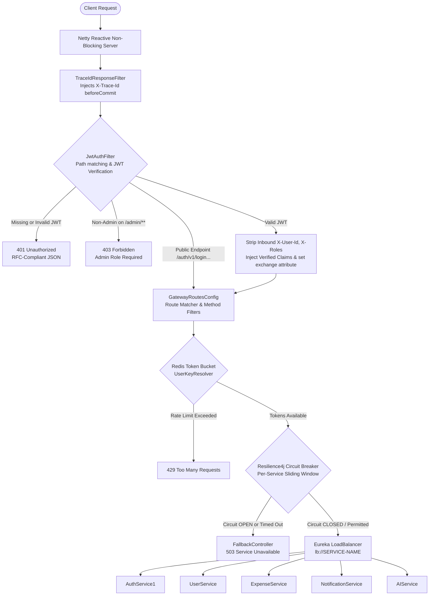

# 🌐 API Gateway (`gateway`)

> High-throughput, non-blocking edge reverse proxy and perimeter security gateway built with **Spring Cloud Gateway (Spring Boot 3.5.5, Java 21)**, **Project Reactor**, and **Netty**. Performs non-blocking cryptographic JWT authentication, anti-spoofing header cleansing, multi-tier distributed Redis rate limiting, Resilience4j circuit breaking, and Zipkin distributed trace propagation.

---

### 🏛️ Architectural Overview & Filter Pipeline



---

### 🛡️ Core Security & Engineering Highlights

#### 1. Zero-Trust Inbound Header Sanitization & Anti-Spoofing
- **The Problem Solved**: Attackers could forge downstream identity headers (`X-User-Id`, `X-Username`, `X-Roles: ROLE_ADMIN`) to elevate privileges or impersonate arbitrary accounts.
- **Implementation**:
  - `JwtAuthFilter` unconditionally mutates the inbound request to strip client-supplied identity headers:
    ```java
    httpHeaders.remove("X-User-Id");
    httpHeaders.remove("X-Username");
    httpHeaders.remove("X-Roles");
    ```
  - Re-injects verified identity headers **solely** from cryptographically validated JWT claims (`subject`, `userId`, `roles`).
  - Sets `exchange.getAttributes().put("userId", userId)` so downstream filters consume trusted server-side state.

#### 2. Defense-in-Depth Path Protection & Admin RBAC
- **The Problem Solved**: Sub-path prefix spoofing or forgotten role checks on internal administration routes.
- **Implementation**:
  - Public routes (`/auth/v1/login`, `/auth/v1/signup`, `/auth/v1/refreshToken`, `/auth/v1/forgot-password`, `/auth/v1/reset-password`) are strictly evaluated using exact collection lookup (`PUBLIC.contains(path)`), preventing prefix-matching bypasses.
  - Defense-in-depth admin protection checks `path.contains("/admin")` and enforces `ROLE_ADMIN` membership, guarding admin endpoints across all microservices (Auth and User services) before requests ever reach internal controllers.

#### 3. Attribute-Driven Distributed Rate Limiting (`UserKeyResolver`)
- **The Problem Solved**: Header-based rate limiting allows attackers to spoof client headers or IPs to exhaust other users' quotas.
- **Implementation**:
  - `UserKeyResolver` extracts the rate-limiting key directly from server-side `exchange.getAttribute("userId")`.
  - Authenticated traffic is keyed as `user:{userId}`, ensuring strict per-user rate quotas regardless of proxy hops or IP rotation.
  - Unauthenticated public endpoints (e.g. login/signup) fall back to client IP (`exchange.getRequest().getRemoteAddress()`), guarded with null-safety defaults (`"unknown-client"`).

#### 4. Multi-Tier Token Bucket Rate Limiting (Redis)
- **The Problem Solved**: Different endpoint categories impose vastly different load characteristics and costs.
- **Implementation**:
  - **Auth Limiter (`authRateLimiter`)**: `1 req/sec`, burst `5`. Prevents credential stuffing and brute-force attacks on `/auth/**`.
  - **Read Limiter (`readRateLimiter`)**: `10 req/sec`, burst `50`. High throughput for cached read requests (`GET` queries).
  - **Write Limiter (`writeRateLimiter`)**: `5 req/sec`, burst `20`. Mid-tier protection for state-mutating requests (`POST`, `PUT`, `PATCH`, `DELETE`).
  - **AI / SMS Limiter (`aiRateLimiter`)**: `1 req/2sec`, burst `10` (token cost = 2). Strictly limits high-cost third-party LLM and SMS invocations.

#### 5. Resilience4j Circuit Breaking & TimeLimiter Isolation
- **The Problem Solved**: Cascading latency, thread exhaustion, and hung connections when a downstream microservice experiences degradation.
- **Implementation**:
  - Every route is wrapped with a named Resilience4j Circuit Breaker instance (`auth-service-cb`, `user-service-cb`, `expense-service-cb`, `notification-service-cb`, `ai-service-cb`).
  - Dedicated TimeLimiter configurations: User service allows `30s` timeout for Cloudinary file uploads, while standard services timeout at `5s`.
  - When failure rate exceeds 50% or slow calls exceed 80%, the circuit opens, redirecting requests to non-blocking fallback endpoints in `FallbackController` (`HTTP 503 Service Unavailable`).

#### 6. Distributed Tracing & Response Header Propagation
- **The Problem Solved**: Correlating client requests with downstream microservice logs in distributed environments.
- **Implementation**:
  - Integrated with **Micrometer Tracing** and OpenTelemetry / Zipkin.
  - `TraceIdResponseFilter` runs with `Ordered.LOWEST_PRECEDENCE` and registers a `beforeCommit` reactive hook on the response:
    ```java
    exchange.getResponse().beforeCommit(() -> {
        Span currentSpan = this.tracer.currentSpan();
        if (currentSpan != null) {
            exchange.getResponse().getHeaders().add("X-Trace-Id", currentSpan.context().traceId());
        }
        return Mono.empty();
    });
    ```
  - Returns `X-Trace-Id` on all outbound responses to clients for end-to-end auditability.

---

### 🚦 Gateway Routing Table

| Route ID | Path Pattern | HTTP Method | Rate Limiter | Circuit Breaker | Target URI |
| :--- | :--- | :--- | :--- | :--- | :--- |
| `auth-service` | `/auth/**` | Any | `authRateLimiter` (1 rps, burst 5) | `auth-service-cb` | `lb://AUTH-SERVICE` |
| `user-service-reads` | `/api/v1/users/**` | `GET` | `readRateLimiter` (10 rps, burst 50) | `user-service-cb` | `lb://USER-SERVICE` |
| `user-service-writes` | `/api/v1/users/**` | `POST`, `PUT`, `PATCH`, `DELETE` | `writeRateLimiter` (5 rps, burst 20) | `user-service-cb` | `lb://USER-SERVICE` |
| `expense-service-reads` | `/api/v1/expenses/**` | `GET` | `readRateLimiter` (10 rps, burst 50) | `expense-service-cb` | `lb://EXPENSE-SERVICE` |
| `expense-service-writes` | `/api/v1/expenses/**` | `POST`, `PUT`, `PATCH`, `DELETE` | `writeRateLimiter` (5 rps, burst 20) | `expense-service-cb` | `lb://EXPENSE-SERVICE` |
| `notification-service-reads` | `/api/v1/notifications/**` | `GET` | `readRateLimiter` (10 rps, burst 50) | `notification-service-cb` | `lb://NOTIFICATION-SERVICE` |
| `notification-service` | `/api/v1/notifications/**` | `POST`, `PUT`, `PATCH`, `DELETE` | `writeRateLimiter` (5 rps, burst 20) | `notification-service-cb` | `lb://NOTIFICATION-SERVICE` |
| `ai-service` | `/api/v1/sms/**` | Any | `aiRateLimiter` (0.5 rps, burst 10) | `ai-service-cb` | `lb://AI-SERVICE` |

---

### 🧪 Comprehensive Gateway Testing Suite

The Gateway test suite leverages **Spring Cloud Gateway Test**, **Project Reactor StepVerifier**, and **MockServerWebExchange** for isolated reactive verification:

```bash
gateway/src/test/java/com/greatest/gateway/
├── GatewayApplicationTests.java    # Full reactive Spring context bootstrap validation
├── JwtAuthFilterTest.java          # Reactive WebFlux filter verification (StepVerifier):
│                                   #  - Public path pass-through
│                                   #  - Missing token 401 Unauthorized rejection
│                                   #  - Non-admin 403 Forbidden rejection
│                                   #  - Header spoofing cleansing & verified claims injection
├── JwtUtilTest.java                # HMAC-SHA256 signature validation, expiry checks & required claims assertions
└── UserKeyResolverTest.java        # Server attribute resolution, client IP fallback & null-safety validation
```

#### Running Gateway Tests:
```bash
# Navigate to service directory
cd gateway

# Run all gateway tests (Windows: .\mvnw.cmd test)
./mvnw test

# Run a clean build and test run
./mvnw clean test
```

---

### ⚙️ Environment Variables & Configuration

| Variable | Description | Default / Example |
| :--- | :--- | :--- |
| `SERVER_PORT` | HTTP Port for Gateway | `8080` |
| `REDIS_HOST` | Redis Server Hostname | `localhost` |
| `REDIS_PORT` | Redis Server Port | `6379` |
| `EUREKA_URI` | Service Discovery Server URI | `http://localhost:8761/eureka/` |
| `JWT_SECRET` | Base64-encoded HMAC-SHA256 Secret (>= 256 bits) | - |
| `JWT_EXPIRATION` | Access Token Expiration (ms) | `3600000` (1 hour) |
| `JWT_REFRESH_EXPIRATION` | Refresh Token Expiration (ms) | `604800000` (7 days) |
| `ZIPKIN_ENDPOINT` | Distributed Tracing OTLP / Zipkin Ingestion | `http://localhost:9411/api/v2/spans` |
