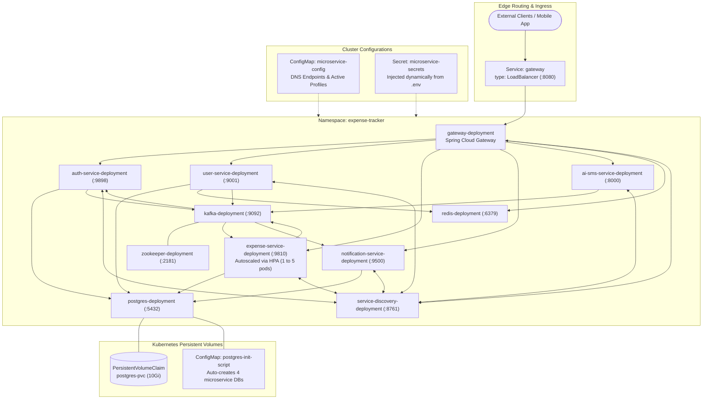

# ☸️ Cloud-Native Kubernetes Orchestration (`k8s`)

> Production Kubernetes deployment manifests, configurations, and autoscaling engine for the FinTrack distributed microservices ecosystem. Designed for local development clusters (Docker Desktop / Minikube / Kind) and enterprise cloud platforms (AWS EKS / GCP GKE).

---

### 🏛️ Kubernetes Service Topology & Architecture



---

### 🛡️ Core Production Engineering Highlights

#### 1. Zero-Secret GitOps Ingestion
- **The Problem Solved**: Hardcoding database passwords, JWT signing keys, or third-party API credentials into version-controlled YAML files creates severe security vulnerabilities.
- **Implementation**:
  - Non-sensitive DNS network endpoints (`POSTGRES_HOST: postgres-service`, `KAFKA_BOOTSTRAP_SERVERS: kafka-service:9092`, `EUREKA_URI: http://service-discovery:8761/eureka/`) reside cleanly in `04-config.yaml`.
  - Sensitive credentials (`JWT_SECRET`, `POSTGRES_PASSWORD`, `GEMINI_API_KEY`, `BREVO_API_KEY`, `CLOUDINARY_*`) are injected dynamically from your local `.env` file directly into cluster memory:
    ```bash
    kubectl create secret generic microservice-secrets --from-env-file=.env -n expense-tracker --dry-run=client -o yaml | kubectl apply -f -
    ```
  - Eliminates plaintext secrets from Git repositories while adhering to 12-factor application standards.

#### 2. Resolving JVM Cold-Start "Death Spirals" via Tuned Probes
- **The Problem Solved**: Java 21 / Spring Boot 3 applications require intensive CPU during JVM classloading, annotation scanning, Flyway migrations, and Eureka registration (~60–90 seconds under local containerized constraints). Overly aggressive default liveness probes (e.g. 30s) interpret warming-up containers as dead, triggering infinite SIGKILL (Exit code 137 / 143) restart loops.
- **Implementation**:
  - Configured with `initialDelaySeconds: 90`, `periodSeconds: 15`, and `failureThreshold: 5` across all Spring Boot deployments.
  - Ensures Kubernetes waits for complete Spring context initialization before activating health-check supervisors.

#### 3. Dynamic Horizontal Pod Autoscaling (`HorizontalPodAutoscaler`)
- **The Problem Solved**: Month-end financial notification spikes or bursts of SMS classifications overwhelm single container instances.
- **Implementation**:
  - Configured `11-expense-hpa.yaml` targeting `expense-service-deployment` with CPU utilization threshold of 70%.
  - Automatically scales replicas from **1 pod to 5 pods** under heavy load and downscales gracefully during idle periods.
  - Paired with PostgreSQL `SELECT FOR UPDATE SKIP LOCKED` so all scaled pods lease distinct outbox events concurrently without duplicate execution.

#### 4. Automatic Multi-Database Provisioning via ConfigMap Mounting
- **The Problem Solved**: Standard PostgreSQL container images only create a single database on startup (`POSTGRES_DB`), whereas this distributed microservices ecosystem requires dedicated schemas (`authservice`, `userservice`, `expenseservice`, `notificationservice`).
- **Implementation**:
  - Created `postgres-init-script` ConfigMap containing `init.sql` mounted into `/docker-entrypoint-initdb.d/init.sql`.
  - Automatically executes on volume initialization to provision all isolated schemas on a single persistent storage claim (`postgres-pvc`).

---

### 📂 Manifest Inventory (`k8s/`)

| File | Resource Kind | Description |
| :--- | :--- | :--- |
| `00-service-discovery.yaml` | Deployment, Service | Netflix Eureka Service Registry (`:8761`). |
| `01-postgres.yaml` | Deployment, Service, PVC, ConfigMap | PostgreSQL 15 database engine with 10Gi persistent storage and automated multi-database initialization. |
| `02-redis.yaml` | Deployment, Service | Redis 7 in-memory cache and distributed lock store (`:6379`). |
| `03-kafka.yaml` | Deployment, Service | Apache Kafka event streaming broker (`:9092`) and Apache ZooKeeper (`:2181`). |
| `04-config.yaml` | ConfigMap | Cluster-wide DNS networking configuration (`microservice-config`). |
| `05-expense-service.yaml` | Deployment, Service | Core financial ledger service (`:9810`) with tuned liveness/readiness probes. |
| `06-auth-service.yaml` | Deployment, Service | Authentication and cryptographic token rotation service (`:9898`). |
| `07-user-service.yaml` | Deployment, Service | User identity and profile service (`:9001`) with Redisson locking. |
| `08-notification-service.yaml` | Deployment, Service | Asynchronous push notification and in-app feed service (`:9500`). |
| `09-ai-sms-service.yaml` | Deployment, Service | FastAPI Gemini 2.5 Flash SMS classification engine (`:8000`). |
| `10-gateway.yaml` | Deployment, Service | Spring Cloud Gateway edge perimeter with `type: LoadBalancer` (`:8080`). |
| `11-expense-hpa.yaml` | HorizontalPodAutoscaler | Autoscaling engine scaling ledger replicas (1–5 pods) based on CPU load. |

---

### 🚀 Local Kubernetes Deployment Guide

```bash
# 1. Start Docker Desktop and ensure Kubernetes is enabled (green indicator)

# 2. Build local container images (into Docker Desktop engine)
docker build -t expensetracker-service-discovery:latest ./service-discovery
docker build -t expensetracker-auth-service:latest ./AuthService1
docker build -t expensetracker-user-service:latest ./userService
docker build -t expensetracker-expense-service:latest ./expenseService
docker build -t expensetracker-notification-service:latest ./notification-service
docker build -t expensetracker-ai-sms-service:latest ./ai-sms-service
docker build -t expensetracker-gateway:latest ./gateway

# 3. Create cluster namespace
kubectl create namespace expense-tracker

# 4. Inject secrets dynamically (Zero-Secret GitOps hygiene)
# Note: Ensure .env does not contain host overrides like POSTGRES_HOST=localhost (which would override microservice-config)
kubectl create secret generic microservice-secrets --from-env-file=.env -n expense-tracker --dry-run=client -o yaml | kubectl apply -f -

# 5. Apply all manifests
kubectl apply -f k8s/

# 6. Monitor pod startup until all pods report 1/1 Running
kubectl get pods -n expense-tracker -w

# 7. Test edge gateway health on host machine
curl http://localhost:8080/auth/v1/health
```
