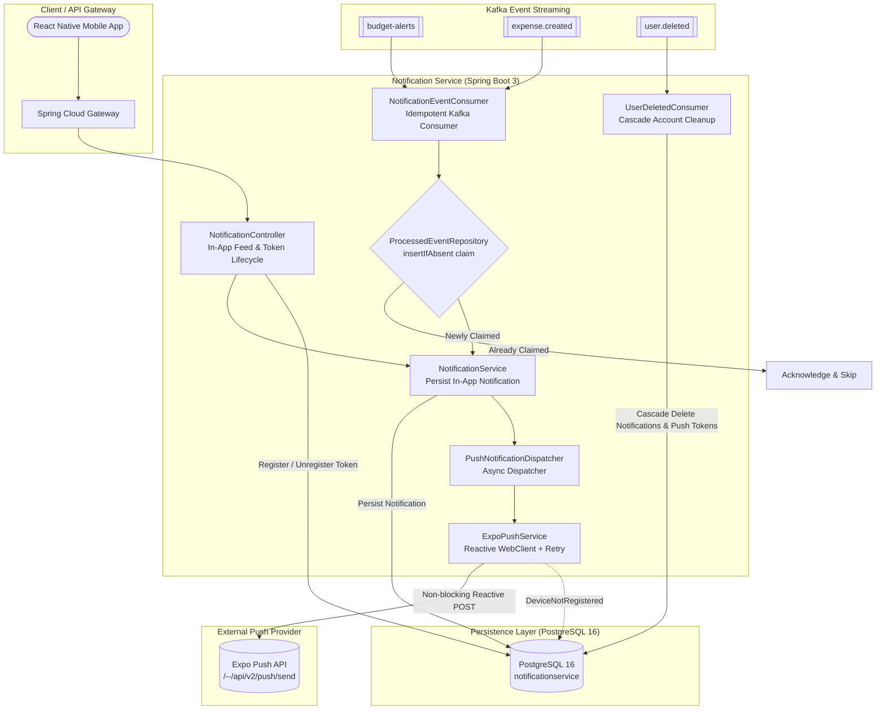

# 🔔 Notification Service (`notification-service`)

> Asynchronous push notification dispatcher and in-app feed manager built with **Spring Boot 3**, **Java 21**, and **Spring WebFlux (Reactive WebClient)**. Consumes Kafka domain events (`budget-alerts`, `expense.created`, `user.deleted`), guarantees atomic message deduplication via transactional idempotency gates, and dispatches remote push alerts to mobile devices through Expo's Push Notification Service.

---

### 🏛️ Architectural Overview & Distributed Patterns



---

### 🛡️ Core Engineering Highlights & Resiliency Patterns

#### 1. Zero-Message-Loss Atomic Consumer Idempotency (`insertIfAbsent`)
- **The Problem Solved**: Kafka provides at-least-once message delivery. Network rebalances, broker reconnections, or container restarts can deliver duplicate `budget-alerts` or `expense.created` events, risking spamming users with duplicate push alerts and phantom in-app entries.
- **Implementation**:
  - The consumer uses `ProcessedEventRepository.insertIfAbsent(eventId, consumerGroup, timestamp)` backed by a database unique constraint on `(event_id, consumer_group)`.
  - The atomic claim occurs inside the consumer transaction. If duplicate events arrive concurrently, exactly one succeeds (`claimed == 1`) and the duplicate exits cleanly (`claimed == 0`) with zero row lock contention or error spam.

#### 2. Non-Blocking Reactive Push Dispatcher with Exponential Backoff & Jitter
- **The Problem Solved**: Third-party push providers (Expo API) can suffer from transient connection timeouts, HTTP 429 rate limits, or network latency spikes. Blocking synchronous HTTP client calls would starve the worker thread pool.
- **Implementation**:
  - Outbound push calls leverage **Spring WebFlux Reactive WebClient** running on `Schedulers.boundedElastic()`.
  - Configured with `Retry.backoff(2, Duration.ofMillis(200)).jitter(0.5)` selectively filtering retryable network and rate-limiting exceptions (`WebClientRequestException`, HTTP 429, HTTP 5xx).
  - Outbound requests never block servlet threads, preserving high message consumption throughput.

#### 3. Self-Cleaning Stale Token Purging (`DeviceNotRegistered`)
- **The Problem Solved**: When users uninstall the mobile app or clear application data, Expo invalidates the push token. Repeatedly pushing to dead tokens degrades delivery reputation and wastes network bandwidth.
- **Implementation**:
  - `ExpoPushService` parses individual ticket receipts from Expo’s batch response.
  - If a ticket reports status `error` with code `DeviceNotRegistered`, the service immediately purges the corresponding token from `push_tokens` in PostgreSQL.

#### 4. Masked PII Logging & Secure Auditability
- **The Problem Solved**: Push notification tokens and phone identifiers must not leak into centralized logs (Loki / Zipkin) in plaintext.
- **Implementation**:
  - Automatic string masking (`mask(token)`) renders `ExponentPushToken[AbC123XyZ]` safely as `ExponentPushToken[AbC1...]]` in log traces.

#### 5. Cascading Relational Event-Driven Cleanup (`user.deleted`)
- **The Problem Solved**: Complying with data privacy regulations (GDPR / right-to-be-forgotten) upon account deletion.
- **Implementation**:
  - `UserDeletedConsumer` consumes `user.deleted` and executes an atomic cascading purge of all user notifications and registered push tokens in a single transaction.

---

### 🔌 REST API Specification

Base Path: `/api/v1/notifications`  
*All endpoints require Bearer JWT authentication. User identity is derived strictly from the verified security context (`authentication.getName()`).*

| Method | Endpoint | Description | Query / Body Parameters |
| :--- | :--- | :--- | :--- |
| `POST` | `/api/v1/notifications/register-token` | Upserts mobile device Expo push notification token. | JSON: `RegisterTokenRequest` (`expoToken`) |
| `GET` | `/api/v1/notifications` | Paginated in-app notification inbox (newest first). | Query: `page` (0-indexed, default 0), `size` (default 20, max 50) |
| `PATCH` | `/api/v1/notifications/{id}/read` | Marks a specific notification as read. | Path: `id` (UUID) |
| `GET` | `/api/v1/notifications/unread-count` | Returns integer count of unread notifications for badge icon. | None |
| `DELETE`| `/api/v1/notifications/token` | Unregisters push token on user logout. | None |

---

### 🗄️ Database Schema & Flyway Migrations

The database is version-controlled via Flyway (`V1__init_notification_schema.sql`):

- **`notifications` Table**: Stores in-app notification records with partial composite index `idx_notifications_user_unread ON notifications(user_id) WHERE is_read = FALSE` for ultra-fast unread badge queries.
- **`push_tokens` Table**: Stores device Expo tokens mapped uniquely to `user_id`.
- **`processed_events` Table**: Tracks processed event IDs scoped by `consumer_group` for guaranteed consumer idempotency.

---

### 🧪 Comprehensive Testing Suite

The `notification-service` includes unit, repository slice (`@DataJpaTest`), and mock consumer test suites:

```bash
notification-service/src/test/java/com/greatest/notification_service/
├── consumers/
│   ├── NotificationEventConsumerTest.java   # Idempotent processing of budget alerts & expense events
│   └── UserDeletedConsumerTest.java         # Cascading account purge on user.deleted
├── controllers/
│   └── NotificationControllerTest.java      # Paginated inbox, unread counts & token lifecycle
├── repositories/
│   ├── NotificationRepositoryTest.java      # @DataJpaTest with H2: partial unread index verification
│   └── PushTokenRepositoryTest.java         # Unique user token mapping assertions
└── services/
    ├── ExpoPushServiceTest.java             # Reactive WebClient mock with DeviceNotRegistered purge
    ├── NotificationServiceTest.java         # Persistence, pagination & read state mutations
    └── PushTokenServiceTest.java            # Upsert & deduplication logic
```

#### Running Notification Service Tests:
```bash
# Navigate to service directory
cd notification-service

# Run all tests (Windows: .\mvnw.cmd test)
./mvnw test
```

---

### ⚙️ Environment Variables & Configuration

| Variable | Description | Default / Example |
| :--- | :--- | :--- |
| `SERVER_PORT` | HTTP Port | `9500` |
| `POSTGRES_HOST` | PostgreSQL Hostname | `postgres-service` / `localhost` |
| `POSTGRES_PORT` | PostgreSQL Port | `5432` |
| `POSTGRES_DB` | Database Name | `notificationservice` |
| `POSTGRES_USER` | Database Username | `postgres` |
| `POSTGRES_PASSWORD` | Database Password | - |
| `KAFKA_BOOTSTRAP_SERVERS` | Kafka Broker addresses | `kafka-service:9092` / `localhost:9092` |
| `JWT_SECRET` | Base64-encoded HMAC-SHA256 Secret (>= 256 bits) | - |
| `EUREKA_URI` | Service Discovery Server URI | `http://service-discovery:8761/eureka/` |
| `ZIPKIN_ENDPOINT` | Distributed Tracing Ingestion Endpoint | `http://localhost:9411/api/v2/spans` |
